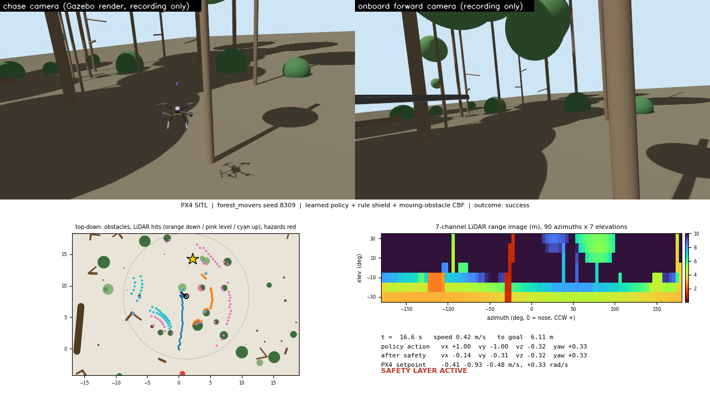
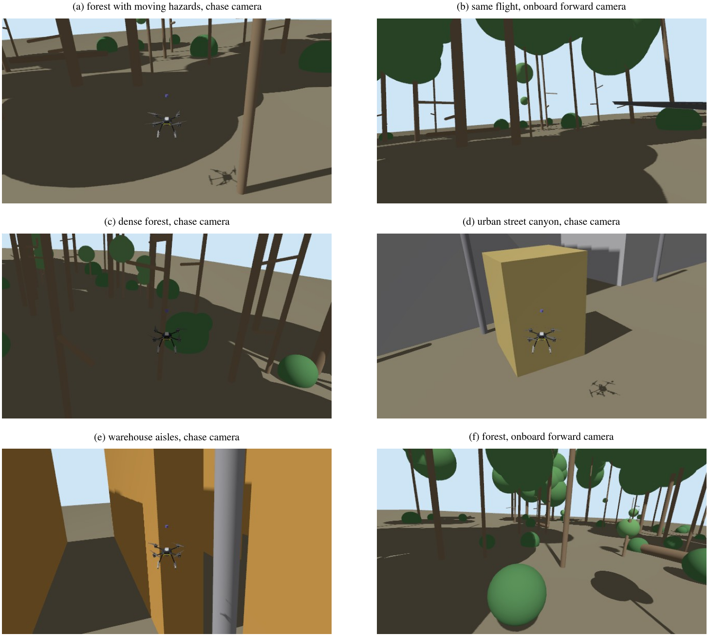

# Safe reinforcement-learning navigation of quadrotors in procedurally generated forests

A quadrotor flies through cluttered forest with a 3-D LiDAR, steered by a PPO policy. The policy is trained in a fast simulator whose dynamics were fitted to PX4, then tested in PX4 software-in-the-loop (SITL) simulation with Gazebo Harmonic. Safety does not rest on the network alone: a rule-based shield and a barrier-function filter sit between the policy and the flight controller, and either one also works with the included planners.



*A PX4 SITL flight through a forest with moving hazards. Top: chase and onboard cameras, recorded for the video only. Bottom: obstacles, LiDAR returns and path seen from above, the 7 × 90 LiDAR range image, and the commands before and after the safety layer.*

## Contents

- **Procedural worlds.** Forests at four stem densities (350 to 1800 stems/ha) built from trunks, saplings, low branches, foliage, bushes, fallen logs and crowns; urban street canyons; warehouse aisles; pole fields. Up to six moving hazards (walkers and flyers) can be added. SITL trials export the same generated worlds to Gazebo.
- **Fast simulator.** `UAVWorldNav-v0`, a Gymnasium environment with a velocity-command cascade fitted to PX4 v1.15 x500 step responses, a 7 × 90-beam LiDAR model and a 50-value observation.
- **Training.** PPO (Stable-Baselines3) with a forest-density curriculum, in three stages: `forest`, `movers` (moving hazards) and `dr` (domain randomization of mass, inertia, time constants, drag, 20–140 ms latency, sensor noise and dropout, wind). PPO-Lagrangian and reward ablations are options of the same script.
- **Safety layers.** A rule shield (`rl_env/safety_shield.py`: stopping-distance speed limit, reverse gate, geofence) and a barrier-function QP filter (`baselines/cbf.py`) with an optional moving-obstacle term that uses LiDAR range rates instead of object tracking.
- **Baselines.** APF, DWA, RRT* and Informed RRT*, run on the same scenarios and seeds as the learned policies.
- **PX4 SITL harness** (`uav_sitl/`). Flies the PX4 x500 with a 3-D LiDAR over MAVLink offboard control and judges collisions against Gazebo ground truth. It also runs complete missions (arm, take off, several waypoints, land, fail-safes), records flights and renders four-panel videos like the one above.
- **Trained policies.** `experiments/world/{forest,movers,dr}/model.zip` and three ablations (`ablation_noshield`, `ablation_lagrangian`, `ablation_noclearance`). The `training_summary.json` next to each model records how it was trained.
- **Earlier pipeline.** The 2-D LiDAR environments `UAVFastNav-v0/v1/v2`, the ROS 2 package `ros2_ws/src/uav_autonomy`, and the scripts and policies of the earlier stages in `experiments/milestone*` and `experiments/retrain_*`.



## Repository layout

| Path | What it holds |
|---|---|
| `rl_env/` | Gymnasium environments, dynamics, LiDAR model, world generator, rule shield |
| `baselines/` | APF, DWA, RRT*, Informed RRT*, barrier-function filter |
| `training/` | PPO training, evaluation, robustness sweeps |
| `uav_sitl/` | PX4 SITL + Gazebo harness: trials, missions, moving hazards, recording, dynamics fitting |
| `models/`, `worlds/` | Gazebo models (x500 with 2-D or 3-D LiDAR, camera rig) and fixed worlds |
| `ros2_ws/` | ROS 2 Jazzy package `uav_autonomy` used by the earlier pipeline |
| `experiments/` | Trained policies, and the training and evaluation scripts of the earlier stages |
| `scripts/` | PX4/ROS setup and WSL helper scripts |
| `tests/` | pytest suite |

## Setup

Tested on Ubuntu 24.04 (also under WSL2 on Windows 11) with Python 3.12.

Training and evaluation in the fast simulator need only Python:

```bash
git clone https://github.com/UnknownEng/Reinforcement-Learning-Based-UAV-Navigation.git
cd Reinforcement-Learning-Based-UAV-Navigation
python3 -m venv --system-site-packages ~/venvs/uav-sitl
source ~/venvs/uav-sitl/bin/activate
pip install torch==2.6.0 --index-url https://download.pytorch.org/whl/cpu
pip install -r requirements.txt
export PYTHONPATH=$PWD
python -m pytest tests -q
```

`--system-site-packages` lets the venv use the Gazebo and ROS 2 Python bindings that come with their apt packages; the helper scripts expect the venv at `~/venvs/uav-sitl`. `tests/test_adapter_node.py` is skipped unless ROS 2 is sourced. A few tests time CPU inference and can fail on a heavily loaded machine.

For PX4 SITL you also need ROS 2 Jazzy, Gazebo Harmonic (gz-sim 8) and PX4-Autopilot v1.15.2 checked out at `~/projects/PX4-Autopilot` (or set `PX4_DIR`). Build once, then load the environment in every new shell:

```bash
bash scripts/setup_wsl_sitl.sh       # builds PX4 SITL, the LiDAR airframe and the ROS package
source scripts/setup_wsl_env.sh      # ROS 2, venv, PYTHONPATH, Gazebo model path, ~/proj link
bash scripts/wsl_check.sh            # checks the toolchain
```

## Fast simulator

```python
import gymnasium as gym
import rl_env  # registers the environments

env = gym.make("UAVWorldNav-v0")
obs, info = env.reset(seed=0)   # obs.shape == (50,)
```

Evaluate the forest policy behind the rule shield on every scenario, 40 fixed seeds each:

```bash
python training/eval_world_policy.py --policy experiments/world/forest/model.zip --shield \
    --scenarios all --episodes 40 --out logs/forest_shield.json
```

`--cbf` adds the barrier-function filter, and `--cbf-moving` the version with the moving-obstacle term:

```bash
python training/eval_world_policy.py --policy experiments/world/forest/model.zip --shield --cbf-moving \
    --scenarios forest_movers --episodes 100 --out logs/movers_cbf.json
```

Baselines run on the same seeds: `apf`, `dwa`, `rrt_star`, `informed_rrt_star`, and `goal`, which flies straight at the goal and only makes sense behind `--shield` or `--cbf`:

```bash
python training/eval_world_policy.py --baseline dwa --scenarios forest_medium,forest_dense \
    --episodes 40 --out logs/dwa.json
```

Give new training runs an explicit `--out`; the default folder is the one the shipped policy lives in:

```bash
python training/train_world_policy.py --stage forest --steps 1200000 --out experiments/world/my_forest
python training/train_world_policy.py --stage movers --init experiments/world/my_forest/model.zip \
    --steps 400000 --out experiments/world/my_movers
python training/train_world_policy.py --stage forest --no-shield --lagrangian --cost-limit 0.5 \
    --out experiments/world/my_lagrangian
```

One-factor-at-a-time robustness sweeps over the physical parameters:

```bash
python training/robustness_sweep.py --policies nominal=experiments/world/movers/model.zip \
    dr=experiments/world/dr/model.zip --episodes 40 --out logs/sweep.json
```

## PX4 SITL

Each trial builds a world from a seed, exports it to Gazebo, starts PX4, takes off and hands control to the policy. Obstacles in Gazebo are visual only. A collision is any approach of the vehicle body to an obstacle in Gazebo's ground truth, so a flight cannot count as a success after brushing a tree.

```bash
python -m uav_sitl.run_trials --suite forest --model experiments/world/forest/model.zip --shield --trials 10
python -m uav_sitl.run_trials --suite forest_movers --model experiments/world/forest/model.zip \
    --shield --cbf-moving --trials 10
python -m uav_sitl.run_missions --model experiments/world/forest/model.zip --cbf-moving --missions 5
```

Suites: `forest`, `forest_movers`, `urban` and `warehouse` for the 3-D LiDAR policies, and `m3`, `m4`, `m5` for the earlier 2-D LiDAR policies. `--gui` opens the Gazebo window.

Record a flight and render it as a video:

```bash
python -m uav_sitl.run_trials --suite forest_movers --model experiments/world/forest/model.zip \
    --shield --cbf-moving --trials 1 --seed0 8309 --record logs/recordings
python -m uav_sitl.make_flight_video logs/recordings/forest_movers_8309 --out logs/flight.mp4
```

SITL timing depends on the CPU. Run trials on an otherwise idle machine; under heavy load PX4 can lose sensor data and enter a failsafe.

Calibration and sensor checks:

```bash
python -m uav_sitl.px4_step_response --out logs/px4_step_response.json   # fly PX4 through velocity steps
python -m uav_sitl.fit_dynamics --log logs/px4_step_response.json --out logs/m1_fit.json
python -m uav_sitl.check_lidar_parity --seed 77                          # Gazebo LiDAR vs. the LiDAR model
```

## Windows + WSL2

The repository can stay on the Windows drive while everything runs in WSL. `wsl.ps1` runs a command in the WSL distro (default `Ubuntu-24.04`, or set `$env:UAV_WSL_DISTRO`) from the project folder with the environment above loaded:

```powershell
.\wsl.ps1 check          # toolchain health check
.\wsl.ps1 test           # pytest in WSL
.\wsl.ps1 run "python training/eval_world_policy.py --policy experiments/world/forest/model.zip --shield --scenarios forest_medium --episodes 10 --out logs/quick.json"
.\wsl.ps1 sitl -Gui      # PX4 SITL + Gazebo with the GUI (WSLg)
.\wsl.ps1 stop           # stop PX4, Gazebo and the ROS nodes
```

`setup_windows.ps1` creates a native Windows venv from `requirements-windows.txt` for the fast simulator and training. `.gitattributes` keeps LF line endings so the shell scripts run in WSL.

## License

BSD 3-Clause. See [LICENSE](LICENSE).

## Author

Mansoor Ahmed, National University of Sciences and Technology (NUST), Islamabad, Pakistan.
